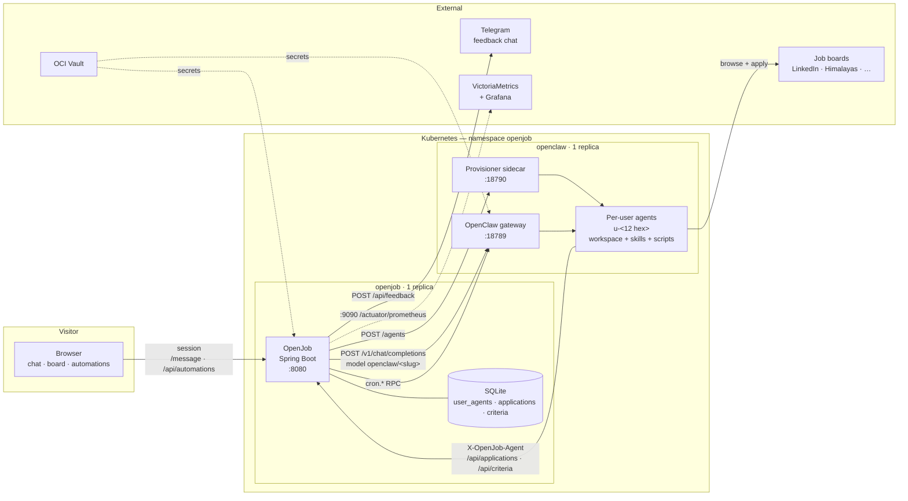

# OpenJob

A web control surface and job board for a personal OpenClaw job-search agent.

OpenJob does not implement an agent. OpenClaw searches job boards, evaluates
postings against the criteria, and applies; OpenJob adds the account, the board,
the automation UI, and the API the agent's scripts write to.

Solid arrows are request paths; dotted arrows are outbound integrations and
secret delivery.

## What lives where

| Concern | Owner |
| --- | --- |
| Agent reasoning, skills, browser automation | OpenClaw (`/home/node/.openclaw/workspaces/<slug>`) |
| Job match criteria | OpenJob (`criteria` table) |
| Job state (`found`/`applied`/`blocked`) | OpenJob (`applications` table) — the only copy |
| UI, four endpoints for the agent, automations | This repo |

Each visitor gets one agent slug (`u-<12 hex>`) in `user_agents` and one
workspace on the `openclaw-data` volume. The slug is written into the workspace
as `.openjob-id`; the scripts read it and send it as `X-OpenJob-Agent`.

## The board API is unauthenticated by design

There is no shared token between the app and the agent. The random slug is the
credential: it is only written into that account's workspace, so knowing it is
what it means to be that account's agent. This keeps no secret in the agent's
environment — see `Security` below.

## Constraints to design around

- One replica: SQLite is a single writer, and the gateway drives one shared
  local Chrome profile for all agents.
- One job is saved per search run, by design.
- Job state is authoritative in SQLite. Nothing else keeps a copy.

## Status

Walking skeleton: a Spring Boot 3.5 / Java 21 app with a chat page, the board
API, and the automations page. `POST /message` forwards the text to the OpenClaw
Gateway (`POST /v1/chat/completions`) and returns the agent's reply. Each visitor
gets their own agent and workspace: the app stores `visitor id -> agent slug` in
`user_agents`, routes to `openclaw/<slug>`, and a provisioner sidecar in the
agent pod creates the agent and workspace on the visitor's first message. The
new agent's config is a copy of the template agent `main` with
only its name and workspace changed, so editing `main` also changes every agent
created afterwards. Workspaces, the gateway config, the shared state (scheduler
and run history), and per-agent sessions live on the `openclaw-data` PVC, so
they survive agent pod restarts. The config is seeded from the image on first
run; on every start an init container rebuilds each agent entry from the image's
template agent `main`, keeping only its slug and workspace, so agent config
changes ship with the image while the rest of the config stays editable on the
volume. The conversation id is the visitor id.

Applications are stored in SQLite (`openjob.db`, table `applications`) and managed
through `GET/POST /api/applications` and `PATCH /api/applications/{id}`; rows are
scoped to the visitor the agent slug belongs to, which the caller sends as
`X-OpenJob-Agent`. Statuses are `found`, `applied`, `blocked`. Per-user match
criteria live in the `criteria` table (`GET/POST /api/criteria`). The agent's
scripts ship in the workspace template under `scripts/` and read their slug from
`.openjob-id`; `sync-workspace` restores them whenever the image changes.

There is no signup and no login. The first page load mints a random visitor id
(`a-<24 hex>`) into an `HttpOnly`, `SameSite=Lax`, `Secure` cookie that lives for
180 days; that cookie is the account, and `user_agents.visitor_id` maps it to an
agent. Clearing site data or switching browsers starts a new account, which is
the trade this MVP makes. The id is a bearer credential: it is never put in a
URL. Mutating requests without a cookie are refused rather than given a new
identity, so a script cannot mint an agent per call. New identities are limited
to 5 per client address per day, messages to 30 per visitor per hour and 100 per
network per hour; the counters are in memory and reset with the process. The
agent API and the anonymous feedback endpoint stay outside the cookie. The
`users` table is dropped on startup, so the old email accounts are gone.

Run with `mvn spring-boot:run`, then open http://localhost:8080. Copy
`.env.example` to `.env`: it needs `OPENJOB_DB_PATH`, `OPENCLAW_URL`,
`OPENCLAW_TOKEN`, `PROVISIONER_URL`. The gateway also needs
`gateway.http.endpoints.chatCompletions.enabled = true`. Without a reachable
provisioner, the first message answers 503 saying the message was not sent.

## Docker

`compose.yaml` runs OpenClaw `2026.10.10` (config baked in from
`deploy/openclaw/openclaw.json`), the provisioner sidecar that creates per-user
agents, a one-shot workspace sync that updates existing workspaces, and this app
talking to them at `http://openclaw:18789`. The workspace template ships in the
repo: `deploy/openclaw/workspace/` (`skills/`, `scripts/`, `AGENTS.md`) is copied
into each user's workspace and reconciled on every start. Put `OPENCODE_API_KEY`
and `OPENCLAW_GATEWAY_TOKEN` in `.env`, then `docker compose up --build`. The app
keeps its SQLite file on the `appdata` volume. Only port 8080 is published.

## Production deployment

Push to `main`. GitHub Actions runs the build, publishes
`ghcr.io/danieliyahu1/openjob` and `ghcr.io/danieliyahu1/openjob-agent` for
`linux/arm64`, and commits the exact published image into `deploy/`. Argo CD
then reconciles the `openjob` namespace on the OCI VM — `deploy/` is the only
deployment source, and the image is pinned by commit SHA.

- URL: https://openjob.danieliyahu.com (public)
- `openjob` — the web app, one replica, SQLite on a 1 Gi `local-path` PVC
- `openclaw` — the agent gateway, ClusterIP only, reached at `http://openclaw:18789`;
  config, workspaces, scheduler state and sessions on a 5 Gi `local-path` PVC

Secrets come from OCI Vault through the `oci-vault` `ClusterSecretStore`; only
the entry names live in Git:

| Vault entry | Used by |
| --- | --- |
| `openjob_gateway_token` | gateway auth from the app |
| `openjob_opencode_api_key` | the agent's model provider |
| `openjob_linkedin_email` / `openjob_linkedin_password` | LinkedIn sign-in |
| `openjob_email_primary_address` / `_password` | Gmail verification codes |
| `openjob_email_secondary_address` / `_password` | Zoho verification codes |

The agent reads those credentials from the environment (`LINKEDIN_EMAIL`,
`EMAIL_PRIMARY_ADDRESS`, …); no credentials live in the repository.

Observability: the app serves Prometheus metrics on the internal port 9090,
scraped through the `openjob-metrics` Service and `VMServiceScrape`. The
`OpenJob / Overview` dashboard covers request rate, errors, latency, agent calls
and their duration, gateway reachability, board size, JVM and container use.

## Feedback

The page has a Feedback button. `POST /api/feedback {"message": "..."}` accepts
up to 1500 characters, rate-limits 5 submissions per 10 minutes per client, and
forwards the text to a private Telegram chat in the same request. Delivery is
best-effort: nothing is stored, so if Telegram fails the page asks the visitor to
try again. The bot token and chat id come from the `openjob-feedback` Secret
(`openjob_telegram_feedback_bot_token`, `openjob_telegram_feedback_chat_id` in
Vault); until those exist the endpoint answers 503 and the dashboard shows the
`disabled` outcome.

Known limits: the CV workflow still has no CV volume on the VM, so the master CV
must be placed in the workspace; a long agent run can outlive Cloudflare's 100 s
origin timeout; a LinkedIn challenge requires a human, which a headless agent
cannot provide; and agents abandoned by visitors who never come back are not
reaped yet, so the workspace volume grows with the number of distinct browsers.
